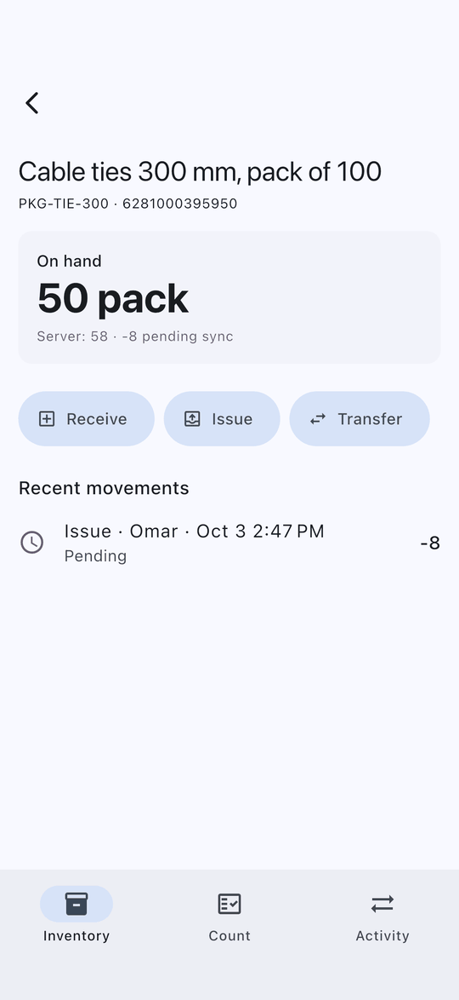
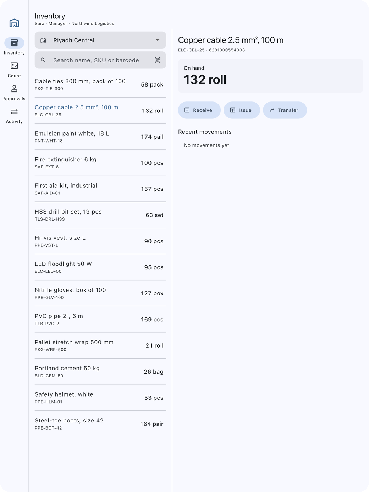
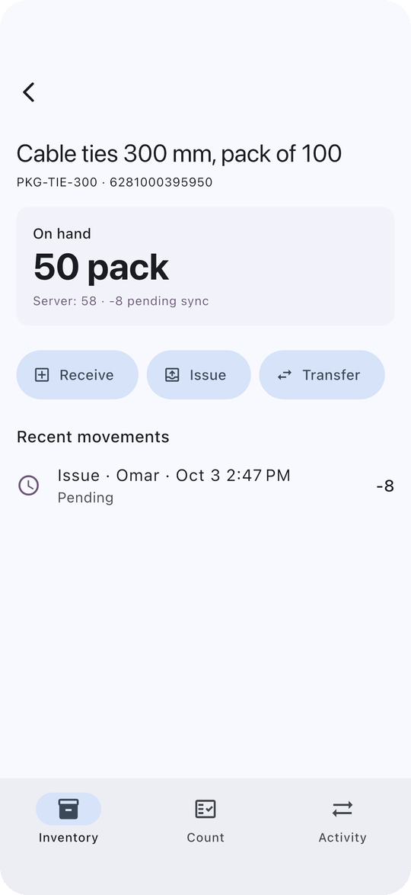
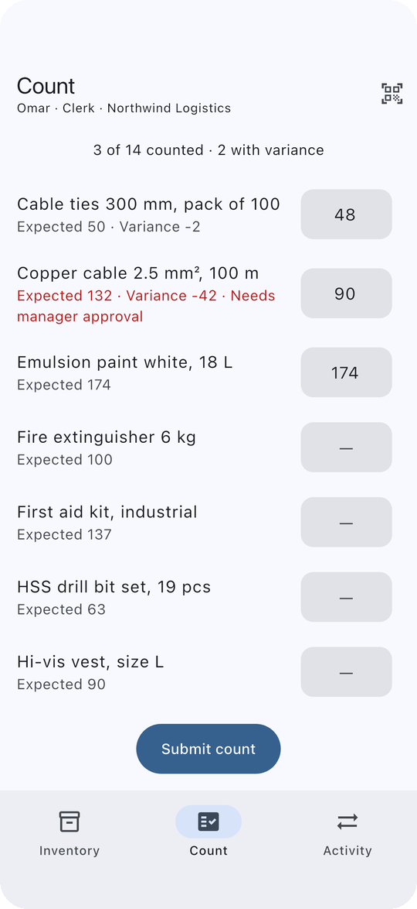
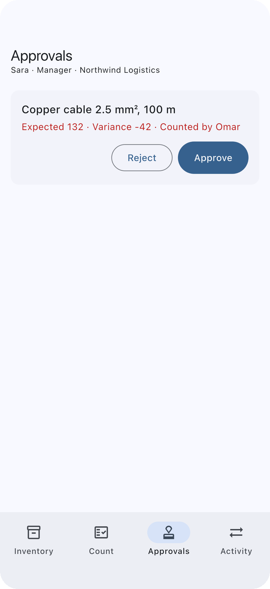
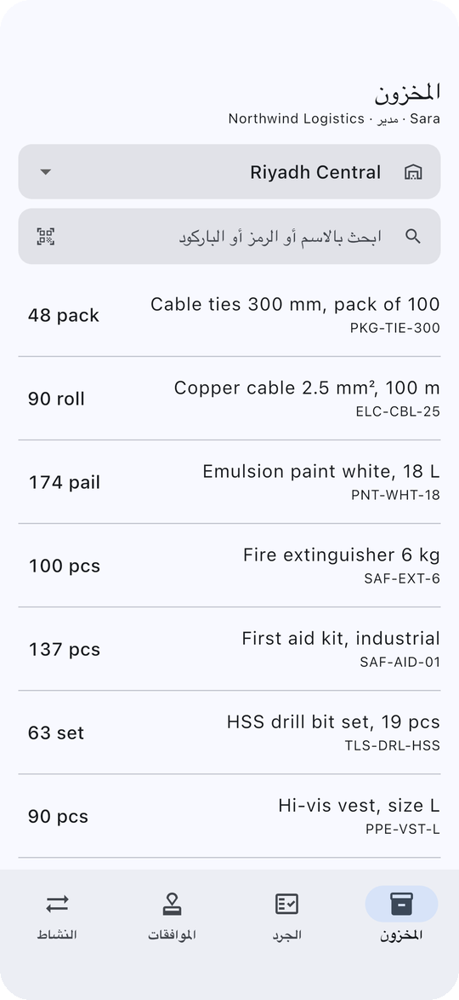

# Flutter Field Ops

[](https://github.com/mokinan/flutter-field-ops/actions/workflows/ci.yml)

An offline-first warehouse inventory app (ERP / SaaS) for field teams.
Clerks receive, issue, transfer and count stock with no signal; managers
approve large count variances. Several companies, three roles, phone and
tablet layouts, Arabic and English.

<p align="center">
  
  
</p>

## The problems it solves

**Several people change the same stock, often offline.** The device never
stores a computed quantity. It keeps the **server-confirmed quantity** plus
its own **pending movements**, and shows their sum. A refresh replaces only
server figures, so local work is *rebased*, never lost or double-counted.
→ [ADR 1](docs/adr/0001-rebase-local-work-on-server-truth.md)

**Someone else emptied the shelf first.** The server rejects the issue. The
movement turns *rejected* with the real available quantity, stops counting,
and the displayed stock corrects itself. Nothing is silently overwritten.

**One company's data must never show up for another.** Each tenant gets its
own SQLite file. All session state (repository, sync queue, screens) is
created per signed-in user and torn down on sign-out.
→ [ADR 2](docs/adr/0002-tenant-isolation.md)

**"Who can do what" keeps changing.** Screens and use cases check
*permissions*, not roles. The UI hides what you cannot do, the domain refuses
it anyway, and so does the server. Count variances above a policy threshold
(5 units or 10%) become approval requests for a manager.
→ [ADR 3](docs/adr/0003-permissions-not-roles.md)

## Built on durable_sync_queue

Writes are delivered by [`durable_sync_queue`](https://github.com/mokinan/durable_sync_queue),
my open-source package:

- Each operation is queued in the **same database transaction** as the
  movement it sends.
- Movements are ordered **per stock line**, while unrelated items sync in
  parallel.
- Retries are **idempotent**.
- Reconnecting triggers an immediate drain.

Integrating it here found two real bugs in the package: a race in forced
drains, and drains inheriting Drift's transaction zone. Both were fixed
upstream, with regression tests.

## Roles

| | Viewer | Clerk | Manager |
|---|:-:|:-:|:-:|
| See stock | ✓ | ✓ | ✓ |
| Receive / issue / transfer | | ✓ | ✓ |
| Count stock | | ✓ | ✓ |
| Apply large count variances | | → approval | ✓ |
| Approve adjustments | | | ✓ |

Demo login: pick a company, tap a role chip (*Manager*, *Clerk*, *Viewer*),
then **Sign in** (password `demo`). The *Activity* tab has field-condition
switches: **Offline mode**, and **Simulate another device** (another clerk
empties a shelf on the server), so conflicts can be reproduced on demand.

## Architecture

```
lib/
├── domain/      entities, permissions, VariancePolicy, use cases, InventoryGateway (interface)
├── data/        InventoryRepository (implements the gateway), sync delivery,
│                per-tenant Drift database, queue store, API contract + fake server
├── features/    inventory · count · approvals · activity · scanner · auth   (Bloc / Cubit)
└── app/         session (tenant-scoped DI), router, adaptive shell, locale
```

Dependencies point inwards. The domain defines `InventoryGateway`, and the
data layer implements it. Unlike the
[fintech wallet](https://github.com/mokinan/flutter-fintech-wallet), this app
has **explicit use cases** (`RecordMovement`, `SubmitCount`,
`DecideAdjustment`), because these rules span permissions, stock and
approvals, so the use cases carry real logic.

**Adaptive layout.** Below 840 dp the app uses bottom navigation and pushes
detail pages. At 840 dp and above it uses a navigation rail and a
master–detail split. Barcode scanning uses `mobile_scanner`, with manual
entry as a fallback for damaged labels or devices without a camera.

## Testing

```bash
flutter test                                    # 24 tests
flutter drive --driver=test_driver/integration_test.dart \
  --target=integration_test/app_test.dart       # end-to-end; phone or tablet
```

What the tests cover:

- **Sync:** pending changes show immediately, then confirm; a refresh rebases
  pending work on newer server figures; server conflicts reject the movement
  and restore the true quantity; transfers update both warehouses; movements
  on one stock line stay in order.
- **Rules:** local stock checks; invalid transfers; viewers blocked in the
  domain; small variances applied and large ones escalated; managers apply
  directly; only managers decide; the server enforces roles too.
- **UI:** each role sees the right tabs and actions; tablets get the rail and
  the detail pane; wrong credentials show an error.
- **End-to-end:** on a phone, a clerk goes offline → issues stock → counts
  (one small and one large variance) → reconnects → everything syncs → a
  manager approves → Arabic. On a tablet, the master–detail layout. The
  screenshots come from these runs.

CI runs format, `flutter analyze --fatal-infos`, the tests with an **80%
coverage gate** on domain, data and cubits, and an Android build.

## Screens

<p align="center">
  
  
  
  
</p>

## Not done (yet)

- Encryption at rest (SQLCipher) for tenant databases.
- Background sync while the app is suspended (WorkManager / BGTaskScheduler).
- A real backend. The included fake server enforces the same rules (roles,
  stock limits, idempotency), so the client is complete against the contract
  in `data/api/field_ops_api.dart`.

## License

MIT
